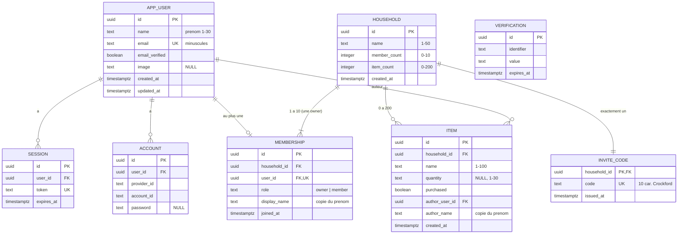

# ERD — Liste de courses familiale

- **Phase** : 2 — architecture
- **Date** : 2026-10-30
- **Auteur** : `db-architect` (statut : propose, accepte a l'approbation du gate architecture)
- **Socle** : `stack.json` — Postgres, Drizzle, better-auth, `tenancy = shared-schema-rls`
- **Isolation** : [ADR-0002](ADR/0002-isolation-multitenant.md) — le foyer n'est jamais un parametre de requete ; il est derive de l'utilisateur de session
- **Roles, fonctions `SECURITY DEFINER`, prenom copie, compteurs de bornes** : [ADR-0005](ADR/0005-roles-postgres-fonctions-definer.md)
- **Format du code d'invitation** : ADR-0004 (en cours, orchestrateur) — voir Q-5

Ce document est la specification de reference du schema. Drizzle (`pnpm db:generate`) produit
les tables, colonnes, contraintes et index declaratifs. Les roles, les politiques RLS, les
triggers et les fonctions sont ecrits a la main dans des migrations SQL versionnees creees par
`drizzle-kit generate --custom` (fichier vide numerote dans le journal Drizzle, puis rempli) :
c'est le seul chemin compatible avec la regle « jamais de SQL manuel hors migrations » de
CLAUDE.md. Une table et sa politique partent dans la meme migration, ou dans deux migrations de
la meme tranche.

---

## 0. Conventions transverses

| Regle | Choix | Raison |
|---|---|---|
| Schemas | `lc` (donnees du foyer), `lc_auth` (tables de better-auth). Rien dans `public`. | Le schema `lc_auth` permet de refuser au role applicatif tout acces aux comptes (pas de `USAGE`), y compris aux adresses e-mail. `public` reste vide : aucun objet ne profite du `search_path` par defaut. |
| Cle primaire | `uuid`, `DEFAULT lc.uuidv7()` | Ordonne dans le temps, sans fuite de volumetrie ni enumeration. `lc.uuidv7()` est definie en PL/pgSQL (0001) : le schema ne depend pas de la version de Postgres (natif seulement a partir de 18, Q-1). Exception : `lc.invite_code`, dont la cle est `household_id` (relation 1-1, §3.3). |
| Horodatage | `timestamptz` uniquement | Jamais `timestamp`. |
| Nullabilite | `NOT NULL` par defaut | Chaque colonne nullable porte sa justification. |
| Suppression | Suppression reelle, aucun `deleted_at` | Le PRD exige la suppression definitive des articles et exclut tout historique. Les foyers et les comptes ne sont jamais supprimes dans le MVP. |
| Montants | Aucun | Produit gratuit (D-001). |
| Texte libre | Toujours borne par `CHECK` : longueur `char_length` **et** absence d'espace de bord `x !~ '^[[:space:]]\|[[:space:]]$'` | Le PRD compare les bornes apres retrait des espaces de bord. L'application retire ces espaces (schema de validation) ; la base refuse ce qui ne l'a pas ete. `char_length` compte des points de code (Q-2). |
| Echappement | Dans les tableaux de ce document, `\|` est l'echappement Markdown de la barre verticale | En SQL, le motif s'ecrit `'^[[:space:]]|[[:space:]]$'`. |
| Nommage | `snake_case`, tables au singulier, contraintes et index nommes explicitement | Les noms de contraintes sont lus par les fonctions pour traduire les erreurs (§4.4). |
| Enumeration | `text` + `CHECK (... IN (...))` | Modifier un `CHECK` est trivial ; ajouter une valeur a un `enum` Postgres est plus contraignant. |

### Codes d'erreur (SQLSTATE de classe `LC`)

Leves uniquement par les fonctions de §4. La couche d'acces les traduit en erreurs metier typees
(valeurs de retour), jamais en 500, sauf `LC001`. Les messages ne contiennent aucun identifiant
ni aucune donnee d'un foyer.

| Code | Sens | Traduction attendue |
|---|---|---|
| `LC001` | `app.user_id` absent, ou compte introuvable | Defaut du serveur (contexte non pose) : 500. Un compte introuvable n'existe pas dans le MVP (pas de suppression de compte). |
| `LC002` | L'appelant appartient deja a un foyer | US-03.4, US-05.4 |
| `LC003` | Code d'invitation inconnu, remplace ou mal forme (un seul code pour les trois) | US-05.2 — ne revele rien |
| `LC004` | Foyer complet (10 membres) | US-05.3 |
| `LC005` | L'appelant n'est pas la responsable | US-11.2, US-11.4, US-12.4 |
| `LC006` | Membre cible introuvable dans le foyer de l'appelant | US-12.5 — ne distingue pas « autre foyer » de « inexistant » |
| `LC007` | La responsable ne peut ni etre retiree ni partir | US-12.3, US-13.3 |
| `LC008` | Liste pleine (200 articles) | US-07.5 |
| `LC009` | L'appelant n'appartient a aucun foyer | US-04.2 |

`23514` (violation de `CHECK`) sur une colonne de texte signale une entree que la validation
applicative aurait du refuser : defaut du serveur, 500. Les deux `CHECK` de bornes
(`household_member_limit`, `household_item_limit`) ne remontent jamais tels quels : les fonctions
les traduisent en `LC004` et `LC008`.

---

## 1. Roles Postgres

Detail et options ecartees : [ADR-0005](ADR/0005-roles-postgres-fonctions-definer.md).

| Role | `LOGIN` | Attributs reimposes a chaque migration de roles | Proprietaire de | Usage |
|---|---|---|---|---|
| `lc_owner` | **non** | `NOSUPERUSER NOCREATEDB NOCREATEROLE NOREPLICATION NOBYPASSRLS NOLOGIN` | schemas `lc` et `lc_auth`, toutes les tables, fonctions `SECURITY INVOKER` | Aucun. Proprietaire inerte : sans politique, il ne voit rien (`FORCE ROW LEVEL SECURITY`). Le test anti-regression `FORCE` passe par `SET ROLE lc_owner` depuis la connexion d'administration des tests. |
| `lc_app` | oui | `NOSUPERUSER NOCREATEDB NOCREATEROLE NOREPLICATION NOBYPASSRLS LOGIN` | rien | Connexion de l'application (Route Handlers, Server Actions) : `DATABASE_URL`. Aucun acces a `lc_auth`. |
| `lc_better_auth` | oui | idem `LOGIN` | rien | Connexion du seul module better-auth : `AUTH_DATABASE_URL` (nom fixe par le contrat de la tranche 001 ; `DATABASE_URL_AUTH` dans ADR-0005). Limite aux quatre tables de `lc_auth`. |
| `lc_definer` | **non** | idem `NOLOGIN` | fonctions `SECURITY DEFINER` (§4), `lc.context_household_id()` | Atteignable uniquement par l'execution d'une fonction qu'il possede. |
| role de migration | — | superutilisateur de l'instance locale ou de CI (connexion d'amorcage `DATABASE_URL_MIGRATE`), hors de ce tableau | rien a la fin d'une migration (tout est cede par `ALTER ... OWNER TO`) | Joue `pnpm db:migrate`. Ne sert jamais aux requetes applicatives. |

Regles de creation (migration `0001`, reprises par toute migration qui touche aux roles) :
- Creation idempotente : `DO $$ BEGIN IF NOT EXISTS (SELECT 1 FROM pg_roles WHERE rolname = 'lc_app') THEN CREATE ROLE lc_app; END IF; END $$;`, jamais de `CREATE ROLE` nu.
- Puis `ALTER ROLE` **inconditionnel** reimposant tous les attributs du tableau (un role cree a la main avec `BYPASSRLS` serait sinon accepte en silence).
- Puis une assertion qui **leve** (sans rien revoquer) si l'un des quatre roles est membre d'un role quelconque, si un role quelconque est membre de l'un d'eux (`pg_auth_members`), ou si un reglage par role existe pour l'un d'eux (`pg_db_role_setting`). Lecon de Signet (migrations 0010, 0011).
- Aucun mot de passe dans une migration : l'humain (local) et la CI (`TEST_ROLE_PASSWORDS`) les posent.
- Premiere migration : `ALTER DEFAULT PRIVILEGES REVOKE EXECUTE ON FUNCTIONS FROM PUBLIC;` **sans `FOR ROLE` et sans `IN SCHEMA`** (s'applique au role de migration, qui cree les fonctions avant de les ceder). Un test cree une fonction apres coup sous le role de migration et verifie que `PUBLIC` ne peut pas l'executer.
- `REVOKE ALL ON SCHEMA lc, lc_auth FROM PUBLIC;` `REVOKE CREATE ON SCHEMA public FROM PUBLIC;`
- `CREATE OR REPLACE FUNCTION` conserve le proprietaire : toute migration qui cree ou remplace une fonction se termine par `ALTER FUNCTION ... OWNER TO` (lecon Signet, ERD §1 point 4). Invariant teste : toute fonction `prosecdef` de `lc` appartient a `lc_definer` ; tout autre objet de `lc` et `lc_auth` appartient a `lc_owner`.

Variables du test de catalogue (`tests/_factory/db-catalog.test.ts`, `.env.test.local`) :
```
TEST_APP_SCHEMAS=lc,lc_auth
TEST_APP_ROLES=lc_owner,lc_app,lc_better_auth,lc_definer
TEST_RLS_EXEMPT_TABLES=
```
Aucune exemption RLS : les tables de better-auth ont RLS forcee elles aussi (§3.1). Le journal
des migrations Drizzle vit dans le schema `drizzle`, hors des schemas applicatifs, et aucun role
applicatif n'y a `USAGE`.

### Matrice des privileges

| Objet | `lc_app` | `lc_better_auth` | `lc_definer` |
|---|---|---|---|
| schema `lc` | `USAGE` | `USAGE` (seulement pour `lc.uuidv7()`, voir §3.1) | `USAGE` |
| schema `lc_auth` | — | `USAGE` | `USAGE` |
| `lc_auth.app_user` | — | `SELECT, INSERT, UPDATE, DELETE` | `SELECT (id, name)` |
| `lc_auth.session`, `account`, `verification` | — | `SELECT, INSERT, UPDATE, DELETE` | — |
| `lc.household` | `SELECT` | — | `SELECT, INSERT, UPDATE (member_count, item_count)` |
| `lc.membership` | `SELECT` | — | `SELECT, INSERT, DELETE` |
| `lc.invite_code` | — | — | `SELECT, INSERT, UPDATE (code, issued_at)` |
| `lc.item` | `SELECT, UPDATE (purchased), DELETE` | — | `SELECT, INSERT` |
| `lc.uuidv7()` | `EXECUTE` (inutile en pratique, inoffensif) | `EXECUTE` | `EXECUTE` |
| `lc.current_user_id()` | `EXECUTE` | — | `EXECUTE` |
| `lc.current_household_id()` | `EXECUTE` | — | proprietaire |
| `lc.context_household_id()` | — | — | proprietaire, seul |
| `lc.new_invite_code()` | — | — | `EXECUTE` |
| fonctions de §4.2 a §4.8 | `EXECUTE` | — | proprietaire |
| fonctions de trigger | — | — | proprietaire |

Personne n'a `TRUNCATE`, `REFERENCES`, `TRIGGER` ni `UPDATE` sur une autre colonne que celles
listees. `lc_app` n'a **aucun** droit d'ecriture sur `household`, `membership`, `invite_code`, ni
d'`INSERT` sur `item` : toute creation passe par une fonction de §4. Un test de catalogue le
verifie (`has_table_privilege`, `has_column_privilege`).

---

## 2. Contexte de session et primitives RLS

Le serveur pose **un seul** reglage, en premiere instruction de chaque transaction, depuis la
session better-auth validee, jamais depuis la requete :

```sql
SELECT set_config('app.user_id', $1, true);   -- equivalent de SET LOCAL, accepte un parametre lie
```

Il n'existe aucun reglage « foyer » pose par l'application (ADR-0002). Le reglage
`app.household_id` existe, mais seules les fonctions de `lc_definer` l'ecrivent et le lisent ;
toute valeur posee par `lc_app` est ecrasee par la premiere instruction de chaque fonction.

### Primitives

| Fonction | Corps | Nature | Proprietaire | `EXECUTE` | Utilisee par |
|---|---|---|---|---|---|
| `lc.current_user_id() RETURNS uuid` | `SELECT nullif(current_setting('app.user_id', true), '')::uuid` | `SECURITY INVOKER`, `LANGUAGE sql`, `STABLE` | `lc_owner` | `lc_app`, `lc_definer` | politiques et fonctions |
| `lc.current_household_id() RETURNS uuid` | `SELECT m.household_id FROM lc.membership m WHERE m.user_id = lc.current_user_id()` | **`SECURITY DEFINER`**, `LANGUAGE sql`, `STABLE`, `SET search_path = pg_catalog, lc, pg_temp` | `lc_definer` | `lc_app` | politiques de `lc_app` **uniquement**, et requetes de l'application (filtre explicite) |
| `lc.context_household_id() RETURNS uuid` | `SELECT nullif(current_setting('app.household_id', true), '')::uuid` | `SECURITY INVOKER`, `LANGUAGE sql`, `STABLE` | `lc_definer` | `lc_definer` seul (`PUBLIC` revoque, aucun `GRANT`) | politiques de `lc_definer` **uniquement** |

`current_household_id()` renvoie au plus une ligne (`membership_user_key` unique) ; aucune ligne
donne `NULL`.

**Absence de recursion sur `membership`.** La politique de `lc_app` sur `membership` appelle
`current_household_id()`, qui lit `membership`. Cette lecture s'execute sous `lc_definer`, dont les
politiques sur `membership` sont `membership_definer_context` (lit le reglage brut, aucune table) et
`membership_definer_self_read` (`user_id = lc.current_user_id()`, aucune table). Aucune n'appelle
`current_household_id()` : la chaine s'arrete au premier niveau. C'est la solution de Signet
(ADR-0011), simplifiee : ici l'appartenance est cherchee par utilisateur seul, il n'y a pas de foyer
« demande » a verifier.

Invariants (verifies par un test de catalogue sur `pg_policies.qual` et `with_check`) :
- **R1** : aucune politique `TO lc_definer` n'appelle `current_household_id()` (recursion, et
  fonctions sans membre encore existant).
- **R2** : aucune politique `TO lc_app` n'appelle `context_household_id()` (elle echouerait de toute
  facon en `42501`, faute d'`EXECUTE`).
- **R3** : toute politique `TO lc_app` d'une table de `lc` compare `household_id` (ou `id` pour
  `household`) a `(SELECT lc.current_household_id())`. La sous-requete scalaire force une
  evaluation unique par instruction (initplan) au lieu d'un appel par ligne.

**Fermeture par defaut.** Sans `app.user_id`, avec une valeur vide, ou pour un compte sans foyer,
`current_household_id()` vaut `NULL` : `household_id = NULL` est faux, aucune ligne n'est visible et
aucune ecriture n'est admise. `current_household_id()` ne leve pas : c'est une primitive de
politique, pas une operation (exception documentee a la regle « echouer bruyamment », comme
`current_org()` de Signet). Une valeur non vide qui n'est pas un UUID fait lever le cast (`22P02`) :
une erreur, jamais une ligne.

**Volatilite `STABLE`** : constante dans une instruction, reevaluee a l'instruction suivante. Un
retrait commite coupe l'acces du membre retire des sa transaction suivante (ADR-0002,
consequences) ; une instruction deja commencee s'acheve sur l'ancien etat (`READ COMMITTED`).
`IMMUTABLE` interdit.

**Filtre explicite applicatif (CLAUDE.md).** Les requetes de `lc_app` filtrent elles aussi :
`WHERE household_id = lc.current_household_id()`. L'application n'a jamais d'identifiant de foyer
venu du client a comparer.

Chaque table de `lc` et de `lc_auth` recoit :
```sql
ALTER TABLE <t> ENABLE ROW LEVEL SECURITY;
ALTER TABLE <t> FORCE  ROW LEVEL SECURITY;
```

---

## 3. Tables

### 3.1 Tables de better-auth (schema `lc_auth`)

Hors donnees du foyer : un compte existe sans foyer (US-01.8). Elles ne portent pas de
`household_id`, exception assumee a la regle « chaque table reference son tenant » : il n'y a pas de
tenant a referencer, et le foyer d'un compte change (depart, retrait).

Configuration better-auth requise :
- `user.modelName = "app_user"` : `user` est un mot reserve SQL, a quoter dans chaque migration
  ecrite a la main (lecon Signet).
- Schema Drizzle declare par `pgSchema("lc_auth")` : Drizzle qualifie les noms, aucun reglage
  `search_path` par role n'est necessaire (et il serait refuse par l'assertion de §1).
- Identifiants `uuid` generes par la base (`DEFAULT lc.uuidv7()`), better-auth configure pour ne pas
  les generer lui-meme. **Point a verifier a l'implementation** : si la version de better-auth
  retenue ne le permet pas, generer un UUIDv7 cote application exige une dependance, donc un ADR.
  `lc_better_auth` recoit `USAGE` sur `lc` et `EXECUTE` sur `lc.uuidv7()` pour evaluer ce `DEFAULT`,
  et aucun autre droit dans `lc`.

#### `lc_auth.app_user`

| Colonne | Type | Contraintes | Note |
|---|---|---|---|
| `id` | `uuid` | PK, `DEFAULT lc.uuidv7()` | |
| `name` | `text` | `NOT NULL`, `CONSTRAINT app_user_name_check CHECK (char_length(name) BETWEEN 1 AND 30 AND name !~ '^[[:space:]]\|[[:space:]]$')` | Le prenom d'affichage (US-01.3, US-01.4, D-009). Non modifiable dans le MVP : aucune route ne l'ecrit apres l'inscription. |
| `email` | `text` | `NOT NULL`, `CHECK (char_length(email) <= 254)`, `CHECK (email = lower(email))` | 254 = RFC 5321. Stockee en minuscules (Q-3) ; l'application la normalise avant de la transmettre a better-auth. |
| `email_verified` | `boolean` | `NOT NULL DEFAULT false` | Exige par better-auth ; toujours `false` (aucune verification, PRD). |
| `image` | `text` | **NULL autorise** | Champ du modele better-auth, jamais renseigne : aucun avatar dans le PRD. |
| `created_at` | `timestamptz` | `NOT NULL DEFAULT now()` | |
| `updated_at` | `timestamptz` | `NOT NULL DEFAULT now()` | |

Index :
- `UNIQUE app_user_email_key (email)` : une adresse = un compte (US-01.5, D-014). C'est aussi
  l'index de recherche a la connexion. Combine au `CHECK` minuscules, l'unicite est insensible a la
  casse sans index fonctionnel.

#### `lc_auth.session`

| Colonne | Type | Contraintes | Note |
|---|---|---|---|
| `id` | `uuid` | PK, `DEFAULT lc.uuidv7()` | |
| `user_id` | `uuid` | `NOT NULL REFERENCES lc_auth.app_user(id) ON DELETE CASCADE` | |
| `token` | `text` | `NOT NULL` | Secret de session, genere par better-auth. |
| `expires_at` | `timestamptz` | `NOT NULL` | |
| `ip_address` | `text` | **NULL autorise** | better-auth ne le renseigne pas selon le transport. |
| `user_agent` | `text` | **NULL autorise** | idem. |
| `created_at`, `updated_at` | `timestamptz` | `NOT NULL DEFAULT now()` | |

Index : `UNIQUE session_token_key (token)` (lecture de session a chaque requete) ;
`session_user_idx (user_id)` (sessions d'un compte, revocation a la deconnexion).
Pas de colonne d'organisation active : le foyer n'est jamais porte par la session (ADR-0002).

#### `lc_auth.account`

| Colonne | Type | Contraintes | Note |
|---|---|---|---|
| `id` | `uuid` | PK, `DEFAULT lc.uuidv7()` | |
| `user_id` | `uuid` | `NOT NULL REFERENCES lc_auth.app_user(id) ON DELETE CASCADE` | |
| `account_id` | `text` | `NOT NULL` | |
| `provider_id` | `text` | `NOT NULL` | Seul `credential` est utilise. |
| `password` | `text` | **NULL autorise** | Empreinte du mot de passe (fournisseur `credential`) ; `NULL` pour un fournisseur externe, inexistant dans le MVP mais prevu par le modele better-auth. |
| `access_token`, `refresh_token`, `id_token`, `scope` | `text` | **NULL autorise** | Champs OAuth du modele better-auth, jamais renseignes (pas de SSO). |
| `access_token_expires_at`, `refresh_token_expires_at` | `timestamptz` | **NULL autorise** | idem. |
| `created_at`, `updated_at` | `timestamptz` | `NOT NULL DEFAULT now()` | |

Index : `UNIQUE account_provider_key (provider_id, account_id)` ; `account_user_idx (user_id)`.

#### `lc_auth.verification`

Exigee par le modele better-auth, inutilisee (aucune verification d'e-mail, aucune reinitialisation).

| Colonne | Type | Contraintes |
|---|---|---|
| `id` | `uuid` | PK, `DEFAULT lc.uuidv7()` |
| `identifier` | `text` | `NOT NULL` |
| `value` | `text` | `NOT NULL` |
| `expires_at` | `timestamptz` | `NOT NULL` |
| `created_at`, `updated_at` | `timestamptz` | `NOT NULL DEFAULT now()` |

Index : `verification_identifier_idx (identifier)`.

Le stockage du limiteur de connexions de better-auth (memoire ou base) est ouvert (Q-4) : s'il est
en base, une cinquieme table `lc_auth.rate_limit` rejoint ce regime.

#### RLS de `lc_auth`

`ENABLE` et `FORCE` sur les quatre tables.

| Politique | Table | Role | Commande | Predicat |
|---|---|---|---|---|
| `<table>_better_auth_all` | les quatre | `lc_better_auth` | `ALL` | `USING (true) WITH CHECK (true)` — l'authentification precede tout contexte ; ce role est borne par ses privileges (quatre tables), pas par ligne |
| `app_user_definer_self_read` | `app_user` | `lc_definer` | `SELECT` | `USING (id = lc.current_user_id())` — lecture du prenom de l'appelant seul, pour le copier (§4) ; colonnes limitees par `GRANT SELECT (id, name)` |

`lc_app` n'a ni `USAGE` sur `lc_auth` ni politique : il ne peut lire aucun compte, aucune adresse,
aucune session. L'absence de politique maintient le refus meme si un `GRANT` etait accorde par
erreur.

---

### 3.2 `lc.household` — racine du tenant

| Colonne | Type | Contraintes | Note |
|---|---|---|---|
| `id` | `uuid` | PK, `DEFAULT lc.uuidv7()` | Le `household_id` reference partout. Jamais transmis par le client. |
| `name` | `text` | `NOT NULL`, `CONSTRAINT household_name_check CHECK (char_length(name) BETWEEN 1 AND 50 AND name !~ '^[[:space:]]\|[[:space:]]$')` | US-03.1, US-03.2. Pas de renommage (PRD). |
| `member_count` | `integer` | `NOT NULL DEFAULT 0`, `CONSTRAINT household_member_count_nonneg CHECK (member_count >= 0)`, `CONSTRAINT household_member_limit CHECK (member_count <= 10)` | Compteur maintenu par trigger (§4.9). `household_member_limit` est le **seul** endroit ou la borne 10 existe en base. |
| `item_count` | `integer` | `NOT NULL DEFAULT 0`, `CONSTRAINT household_item_count_nonneg CHECK (item_count >= 0)`, `CONSTRAINT household_item_limit CHECK (item_count <= 200)` | Idem pour la borne 200 (coches compris, D-012). |
| `created_at` | `timestamptz` | `NOT NULL DEFAULT now()` | |

Index : la PK seule. Aucune recherche par nom.

Pas de colonne de responsable : la responsable est la ligne `membership` de role `owner` (§3.3),
source unique. Pas de `ON DELETE` a choisir pour les tables filles au-dela de `RESTRICT` : un foyer
n'est jamais supprime (PRD).

**RLS**

| Politique | Role | Commande | Predicat |
|---|---|---|---|
| `household_member_select` | `lc_app` | `SELECT` | `USING (id = (SELECT lc.current_household_id()))` |
| `household_definer_select` | `lc_definer` | `SELECT` | `USING (id = lc.context_household_id())` |
| `household_definer_insert` | `lc_definer` | `INSERT` | `WITH CHECK (id = lc.context_household_id())` |
| `household_definer_update` | `lc_definer` | `UPDATE` | `USING (id = lc.context_household_id()) WITH CHECK (id = lc.context_household_id())` — les seules colonnes modifiables sont les compteurs (`GRANT UPDATE (member_count, item_count)`) |

---

### 3.3 `lc.membership` — appartenance et role

| Colonne | Type | Contraintes | Note |
|---|---|---|---|
| `id` | `uuid` | PK, `DEFAULT lc.uuidv7()` | Identifiant vise par le retrait (§4.6). Une personne qui revient obtient une nouvelle ligne : une demande de retrait en retard sur l'ancienne ligne echoue au lieu de retirer la personne revenue. |
| `household_id` | `uuid` | `NOT NULL REFERENCES lc.household(id) ON DELETE RESTRICT` | Reference tenant directe. |
| `user_id` | `uuid` | `NOT NULL REFERENCES lc_auth.app_user(id) ON DELETE RESTRICT` | `RESTRICT` : la suppression de compte est hors MVP (R1) ; le jour ou elle arrive, elle devra decider du sort de l'appartenance au lieu d'en heriter en silence. |
| `role` | `text` | `NOT NULL`, `CONSTRAINT membership_role_check CHECK (role IN ('owner', 'member'))` | Les deux roles du PRD. |
| `display_name` | `text` | `NOT NULL`, `CONSTRAINT membership_display_name_check` (memes regles que `app_user.name`, 1 a 30) | **Copie** de `app_user.name` a l'entree dans le foyer (ADR-0005, partie 3). US-10.1. |
| `joined_at` | `timestamptz` | `NOT NULL DEFAULT now()` | Ordre d'affichage de la liste des membres. |

Index :
- `UNIQUE membership_user_key (user_id)` : un utilisateur dans **au plus un** foyer (PRD). Sert
  aussi `current_household_id()`, appelee a chaque requete. C'est cet index qui refuse la seconde de
  deux adhesions concurrentes du meme compte.
- `UNIQUE membership_one_owner_idx (household_id) WHERE role = 'owner'` : au plus une responsable
  par foyer, en base.
- `membership_household_idx (household_id, joined_at)` : liste des membres d'un foyer.

**Invariants portes par la base**
- **Au moins une responsable** : trigger `membership_protect_owner` `BEFORE DELETE ... FOR EACH
  ROW`, fonction `lc.membership_protect_owner()` (`SECURITY INVOKER`, aucune lecture de table) : si
  `OLD.role = 'owner'`, `RAISE EXCEPTION USING ERRCODE = 'LC007'`. Aucun chemin, pas meme une
  fonction de §4 mal ecrite, ne supprime la responsable. Pas de cas de cascade a menager : un foyer
  n'est jamais supprime.
- **Ligne immuable** : aucun role n'a `UPDATE` sur `membership`, et le trigger
  `membership_immutable` `BEFORE UPDATE ... FOR EACH ROW` (`SECURITY INVOKER`) leve toujours
  (`P0001`). Le role, le foyer et le prenom d'une appartenance ne changent jamais : on part et on
  revient.
- **La responsable est la creatrice** : la seule insertion de role `owner` est dans
  `lc.create_household()` ; `lc.join_household()` insere toujours `member`.
- **Au moins une ligne par foyer** : garanti par la transaction de `create_household()` (le foyer et
  la ligne `owner` sont crees ensemble) puis par `membership_protect_owner`. Aucune contrainte
  differee supplementaire : elle n'aurait qu'un seul chemin d'insertion a couvrir.

**RLS**

| Politique | Role | Commande | Predicat |
|---|---|---|---|
| `membership_member_select` | `lc_app` | `SELECT` | `USING (household_id = (SELECT lc.current_household_id()))` |
| `membership_definer_context` | `lc_definer` | `ALL` (`GRANT SELECT, INSERT, DELETE`) | `USING (household_id = lc.context_household_id()) WITH CHECK (household_id = lc.context_household_id())` |
| `membership_definer_self_read` | `lc_definer` | `SELECT` | `USING (user_id = lc.current_user_id())` |

Un compte sans foyer ne voit aucune ligne, y compris la sienne (il n'en a pas) : c'est ainsi que
l'application detecte la page « sans foyer ».

---

### 3.4 `lc.invite_code` — code d'invitation

| Colonne | Type | Contraintes | Note |
|---|---|---|---|
| `household_id` | `uuid` | **PK**, `REFERENCES lc.household(id) ON DELETE RESTRICT` | Un code par foyer, par construction. Cle = cle etrangere : relation 1-1, pas de second identifiant a exposer. |
| `code` | `text` | `NOT NULL`, `CONSTRAINT invite_code_format CHECK (code ~ '^[0-9A-HJKMNP-TV-Z]{10}$')` | Forme normalisee (ADR-0004) : 10 caracteres de l'alphabet de Crockford, majuscules, sans tiret ni espace. Stocke en clair : la responsable doit pouvoir le relire (US-11.1). |
| `issued_at` | `timestamptz` | `NOT NULL DEFAULT now()` | Date d'emission du code en vigueur. Aucune expiration (PRD) ; sert a la tracabilite en cas de fuite (R3). |

Index :
- PK `(household_id)`.
- `UNIQUE invite_code_code_key (code)` : unicite globale (un code designe un seul foyer, US-11.5)
  et index de la recherche transverse de `join_household()`.

Regeneration = `UPDATE` de `code` sur la ligne existante : l'ancien code cesse d'exister au
`COMMIT`, il n'y a pas de liste d'anciens codes a invalider.

**Pourquoi une table separee et pas une colonne de `household`** : `lc_app` lit `household` (nom du
foyer pour tous les membres). Une colonne `code` y serait lisible par tous les membres, sauf
privileges par colonne, ou un `SELECT *` echoue au premier usage. Ici `lc_app` n'a **aucun** droit
sur `invite_code` : la lecture passe par `get_invite_code()`, qui verifie le role.

**RLS**

| Politique | Role | Commande | Predicat |
|---|---|---|---|
| `invite_code_definer_context` | `lc_definer` | `ALL` (`GRANT SELECT, INSERT, UPDATE (code, issued_at)`) | `USING (household_id = lc.context_household_id()) WITH CHECK (household_id = lc.context_household_id())` |
| `invite_code_definer_lookup` | `lc_definer` | `SELECT` | `USING (code = nullif(current_setting('app.invite_code_lookup', true), ''))` — reglage transitoire pose par `join_household()` puis remis a vide (patron Signet `invitation_definer_token_lookup`) ; absent ou vide : aucune ligne |

Aucune politique pour `lc_app` ni `lc_better_auth`.

---

### 3.5 `lc.item` — article

| Colonne | Type | Contraintes | Note |
|---|---|---|---|
| `id` | `uuid` | PK, `DEFAULT lc.uuidv7()` | Identifiant vise par cocher, decocher, supprimer. |
| `household_id` | `uuid` | `NOT NULL REFERENCES lc.household(id) ON DELETE RESTRICT` | Reference tenant directe. |
| `name` | `text` | `NOT NULL`, `CONSTRAINT item_name_check CHECK (char_length(name) BETWEEN 1 AND 100 AND name !~ '^[[:space:]]\|[[:space:]]$')` | US-07.1, US-07.2. Doublons autorises : aucun index unique (US-07.4). |
| `quantity` | `text` | **NULL autorise** ; `CONSTRAINT item_quantity_check CHECK (quantity IS NULL OR (char_length(quantity) BETWEEN 1 AND 30 AND quantity !~ '^[[:space:]]\|[[:space:]]$'))` | `NULL` = quantite absente (US-07.3, D-014) ; une chaine vide est interdite, il n'y a qu'une representation de l'absence. |
| `purchased` | `boolean` | `NOT NULL DEFAULT false` | Etat « achete » (US-08). Un article ajoute est non coche. |
| `author_user_id` | `uuid` | `NOT NULL REFERENCES lc_auth.app_user(id) ON DELETE RESTRICT` | L'auteur, fait immuable de l'article. `RESTRICT` : meme raison que `membership.user_id` (R1). |
| `author_name` | `text` | `NOT NULL`, `CONSTRAINT item_author_name_check` (memes regles que `app_user.name`) | **Copie** du prenom de l'auteur a l'ajout (ADR-0005, partie 3). Survit au depart ou au retrait de l'auteur (US-06.2, US-12.2, US-13.2) sans lecture de `lc_auth`. |
| `created_at` | `timestamptz` | `NOT NULL DEFAULT now()` | Ordre d'ajout (US-06.4). |

Index :
- `item_household_order_idx (household_id, created_at, id)` : sert la lecture de la liste
  (`WHERE household_id = ... ORDER BY created_at, id`) et le filtre RLS. `id` (UUIDv7) departage
  deux ajouts de meme horodatage.
- Pas d'index sur `author_user_id` : il ne sert qu'a la verification `RESTRICT` d'une suppression de
  compte, inexistante dans le MVP.

Aucune colonne `updated_at` : seul `purchased` change, et le PRD ne demande ni quand ni par qui.

**RLS**

| Politique | Role | Commande | Predicat |
|---|---|---|---|
| `item_member_select` | `lc_app` | `SELECT` | `USING (household_id = (SELECT lc.current_household_id()))` |
| `item_member_update` | `lc_app` | `UPDATE` (`GRANT UPDATE (purchased)`) | `USING (household_id = (SELECT lc.current_household_id())) WITH CHECK (household_id = (SELECT lc.current_household_id()))` |
| `item_member_delete` | `lc_app` | `DELETE` | `USING (household_id = (SELECT lc.current_household_id()))` |
| `item_definer_select` | `lc_definer` | `SELECT` | `USING (household_id = lc.context_household_id())` (necessaire a `INSERT ... RETURNING`) |
| `item_definer_insert` | `lc_definer` | `INSERT` | `WITH CHECK (household_id = lc.context_household_id())` |

Cocher, decocher et supprimer sont des requetes directes de `lc_app` : tout membre peut agir sur tout
article de son foyer (US-08.3, US-09.1), la RLS suffit et aucun role n'est a verifier. Une requete
sur un article d'un autre foyer touche zero ligne : l'application la refuse (US-08.4, US-09.2) sans
avoir rien lu de l'autre foyer. L'ajout passe par `add_item()` (§4.8) : l'auteur et le foyer ne
sont pas fournis par l'appelant.

---

## 4. Fonctions `SECURITY DEFINER` (liste fermee)

Toute fonction `SECURITY DEFINER` ajoutee hors de cette liste est un signal de revue
d'architecture (amendement de l'ADR-0005), pas un detail d'implementation.

### 4.1 Regles communes (liste obligatoire de `rules/drizzle-postgres.md`)

1. `SET search_path = pg_catalog, lc, pg_temp` dans la definition, `pg_temp` en dernier ; toutes les
   tables qualifiees (`lc.`, `lc_auth.`).
2. Proprietaire `lc_definer` (`NOLOGIN NOBYPASSRLS`), par `ALTER FUNCTION ... OWNER TO lc_definer`
   dans la meme migration.
3. **Contexte d'abord** : la premiere instruction lit `lc.current_user_id()` et leve `LC001` s'il est
   `NULL` (sauf fonctions de trigger, qui n'ont pas d'utilisateur), puis ecrase `app.household_id`
   (valeur de confiance, ou chaine vide tant que le foyer n'est pas connu). Un `app.household_id`
   pose par l'appelant n'est jamais lu. Avant de rendre la main, la fonction remet
   `app.household_id` a vide (les triggers restaurent la valeur precedente).
4. Tout `UPDATE` ou `DELETE` qui doit toucher une ligne verifie `GET DIAGNOSTICS n = ROW_COUNT` et
   leve si `n = 0` (code metier quand le cas est attendu, `P0001` sinon).
5. `REVOKE ALL ON FUNCTION ... FROM PUBLIC`, puis `GRANT EXECUTE` au seul role appelant indique.
6. Tests : appel sans `app.user_id` (erreur `LC001` exigee) ; appel avec un `app.household_id`
   etranger force par l'appelant (ignore) ; isolation croisee entre deux foyers.
7. `VOLATILE` (sauf `current_household_id`, `STABLE`) : elles ecrivent un reglage de session.
8. Les erreurs de borne sont traduites ainsi : l'instruction d'insertion est enveloppee dans un bloc
   `BEGIN ... EXCEPTION WHEN check_violation THEN GET STACKED DIAGNOSTICS v_con = CONSTRAINT_NAME`,
   qui releve le code `LC` si `v_con` est la contrainte de borne attendue et releve l'erreur
   d'origine (`RAISE;`) sinon. Meme principe pour `unique_violation` sur `membership_user_key`.

### 4.2 `lc.current_household_id()` — primitive de politique

Specifiee en §2. Exception documentee au point 3 : ne leve pas sur contexte absent, renvoie `NULL`.
`EXECUTE` : `lc_app`. Politique qui la laisse agir : `membership_definer_self_read`.

### 4.3 `lc.create_household(p_name text) RETURNS void`

US-03. Appelant : `lc_app`.

1. `v_user := lc.current_user_id()` ; `NULL` : `LC001`.
2. `v_hh := lc.uuidv7()` ; `set_config('app.household_id', v_hh::text, true)`.
3. Si une ligne `lc.membership` existe pour `v_user` (lecture par `membership_definer_self_read`) :
   `LC002`.
4. `v_name := name` de `lc_auth.app_user` ou `id = v_user` (`app_user_definer_self_read`) ; aucune
   ligne : `LC001`.
5. `INSERT INTO lc.household (id, name) VALUES (v_hh, p_name)` — `household_name_check` refuse un
   nom hors bornes (`23514`, defaut de validation applicative).
6. `INSERT INTO lc.membership (household_id, user_id, role, display_name) VALUES (v_hh, v_user,
   'owner', v_name)` ; le trigger porte `member_count` a 1. `unique_violation` sur
   `membership_user_key` (adhesion concurrente du meme compte) : `LC002`.
7. `INSERT INTO lc.invite_code (household_id, code) VALUES (v_hh, lc.new_invite_code())` ;
   `unique_violation` sur `invite_code_code_key` : nouvel essai, 5 au plus, puis `P0001`.
8. `set_config('app.household_id', '', true)`.

Politiques utilisees : `membership_definer_self_read`, `app_user_definer_self_read`,
`household_definer_insert`, `membership_definer_context`, `invite_code_definer_context`,
`household_definer_select`/`_update` (trigger). Toute erreur annule l'ensemble : jamais de foyer
sans responsable ni sans code (US-03.3). Retourne `void` : l'application relit le foyer par
`current_household_id()`, l'identifiant n'a pas a circuler.

### 4.4 `lc.join_household(p_code text) RETURNS void`

US-05. Appelant : `lc_app`. Seule operation transverse aux foyers (ADR-0002).

1. `v_user := lc.current_user_id()` ; `NULL` : `LC001`. `set_config('app.household_id', '', true)`.
2. Ligne `membership` existante pour `v_user` : `LC002` (US-05.4).
3. `p_code IS NULL` ou `p_code !~ '^[0-9A-HJKMNP-TV-Z]{10}$'` : `LC003`. La fonction ne normalise pas :
   la normalisation de la saisie est faite une fois, par le schema de validation applicatif (Q-5).
4. `set_config('app.invite_code_lookup', p_code, true)` ; `SELECT household_id INTO v_hh FROM
   lc.invite_code WHERE code = p_code` ; `set_config('app.invite_code_lookup', '', true)`. Aucune
   ligne : `LC003`.
5. `set_config('app.household_id', v_hh::text, true)`.
6. `PERFORM 1 FROM lc.invite_code WHERE household_id = v_hh AND code = p_code FOR SHARE` ; aucune
   ligne : `LC003`. Le verrou partage bloque une regeneration concurrente jusqu'a la fin de
   l'adhesion ; si la regeneration a deja commite, la ligne relue ne correspond plus et l'adhesion est
   refusee. L'ancien code est donc invalide des le `COMMIT` de la regeneration (US-11.3).
   (`FOR SHARE` exige un privilege `UPDATE` sur une colonne : `UPDATE (code, issued_at)` le fournit.)
7. `v_name` lu comme en §4.3 (4) ; aucune ligne : `LC001`.
8. `INSERT INTO lc.membership (household_id, user_id, role, display_name) VALUES (v_hh, v_user,
   'member', v_name)` ; le trigger incremente `member_count`. `check_violation` sur
   `household_member_limit` : `LC004` (US-05.3). `unique_violation` sur `membership_user_key` :
   `LC002`.
9. `set_config('app.household_id', '', true)`.

`LC003` ne distingue pas code inconnu, remplace ou mal forme, et aucun message ne contient de donnee
du foyer (US-05.2). Les refus `LC002` et `LC003` precedent `LC004` : un compte deja membre ou un
code faux n'apprend pas qu'un foyer est complet.

### 4.5 `lc.get_invite_code() RETURNS text` et `lc.regenerate_invite_code() RETURNS text`

US-11. Appelant : `lc_app`. Prefixe commun :
1. `v_user := lc.current_user_id()` ; `NULL` : `LC001`. `set_config('app.household_id', '', true)`.
2. Lecture de la ligne `membership` de `v_user` (`membership_definer_self_read`) : aucune, `LC009` ;
   `role <> 'owner'`, `LC005` (US-11.2, US-11.4).
3. `set_config('app.household_id', v_hh::text, true)`.

`get_invite_code` : `SELECT code FROM lc.invite_code WHERE household_id = v_hh` ; aucune ligne :
`P0001` (invariant rompu). Remet le contexte a vide et renvoie le code.

`regenerate_invite_code` : lit le code en vigueur, tire `v_new := lc.new_invite_code()` jusqu'a
obtenir une valeur differente, puis `UPDATE lc.invite_code SET code = v_new, issued_at = now()
WHERE household_id = v_hh` ; `ROW_COUNT <> 1` : `P0001` ; `unique_violation` sur
`invite_code_code_key` : nouveau tirage, 5 essais au plus, puis `P0001`. Remet le contexte a vide
et renvoie le nouveau code. Un membre qui n'est pas la responsable ne modifie rien (`LC005` leve
avant toute ecriture).

### 4.6 `lc.remove_member(p_membership_id uuid) RETURNS void`

US-12. Appelant : `lc_app`.
1. Prefixe de §4.5 (identite `LC001`, `LC009`, `LC005` si l'appelant n'est pas la responsable,
   contexte pose sur son foyer).
2. `p_membership_id` egal a l'identifiant de la ligne de l'appelant : `LC007` (US-12.3).
3. `DELETE FROM lc.membership WHERE id = p_membership_id AND household_id = v_hh AND role =
   'member'` ; `ROW_COUNT = 0` : `LC006` (cible inexistante, deja partie, ou d'un autre foyer —
   indistinguables, US-12.5). Le trigger decremente `member_count`.
4. Contexte remis a vide.

Les articles de la personne retiree restent (aucune cle de `item` vers `membership`). Son acces
cesse a sa transaction suivante (`current_household_id()` renvoie `NULL`).

### 4.7 `lc.leave_household() RETURNS void`

US-13. Appelant : `lc_app`.
1. `v_user := lc.current_user_id()` ; `NULL` : `LC001`. `set_config('app.household_id', '', true)`.
2. Ligne `membership` de `v_user` : aucune, `LC009` ; `role = 'owner'`, `LC007` (US-13.3).
3. `set_config('app.household_id', v_hh::text, true)`.
4. `DELETE FROM lc.membership WHERE id = v_membership_id AND role = 'member'` ; `ROW_COUNT = 0` :
   `LC009` (retire entre la lecture et la suppression).
5. Contexte remis a vide.

### 4.8 `lc.add_item(p_name text, p_quantity text) RETURNS uuid`

US-07. Appelant : `lc_app`. `p_quantity` `NULL` = quantite absente (l'application convertit une
quantite vide ou faite d'espaces en `NULL`, US-07.3).
1. `v_user := lc.current_user_id()` ; `NULL` : `LC001`. `set_config('app.household_id', '', true)`.
2. Ligne `membership` de `v_user` (`household_id`, `display_name`) : aucune, `LC009` (US-04.2).
3. `set_config('app.household_id', v_hh::text, true)`.
4. `INSERT INTO lc.item (household_id, name, quantity, author_user_id, author_name) VALUES (v_hh,
   p_name, p_quantity, v_user, v_display_name) RETURNING id` ; le trigger incremente `item_count`.
   `check_violation` sur `household_item_limit` : `LC008` (US-07.5).
5. Contexte remis a vide ; renvoie l'identifiant de l'article.

Le prenom vient de la ligne d'appartenance, deja copiee depuis `app_user` : identique tant que le
prenom n'est pas modifiable (PRD), et `add_item` ne lit pas `lc_auth`.

### 4.9 Fonctions de trigger des compteurs

`lc.membership_count_trg()` (`AFTER INSERT OR DELETE ON lc.membership FOR EACH ROW`) et
`lc.item_count_trg()` (`AFTER INSERT OR DELETE ON lc.item FOR EACH ROW`). `SECURITY DEFINER`,
proprietaire `lc_definer`, aucun `EXECUTE` accorde (un trigger ne verifie pas ce droit au
declenchement).

1. Premiere instruction : `v_prev := current_setting('app.household_id', true)` puis
   `set_config('app.household_id', <NEW ou OLD>.household_id::text, true)`. Valeur de confiance :
   la ligne a deja passe le `WITH CHECK` (insertion) ou le `USING` (suppression) de la politique de
   son role.
2. `UPDATE lc.household SET member_count = member_count ± 1 WHERE id = <...>` (respectivement
   `item_count`). `ROW_COUNT <> 1` : `P0001`. Un depassement leve `23514` sur
   `household_member_limit` ou `household_item_limit`, traduit par la fonction appelante (§4.1, 8).
3. `set_config('app.household_id', coalesce(v_prev, ''), true)`, retour `NULL`.

Pourquoi `SECURITY DEFINER` : `lc.item_count_trg()` se declenche aussi sur un `DELETE` d'article
fait directement par `lc_app`. En `SECURITY INVOKER`, `lc_app` devrait avoir `UPDATE` sur les
compteurs et pourrait les remettre a zero pour contourner la borne.

Pourquoi des triggers et pas un comptage dans chaque fonction : le compteur suit **toute**
insertion et **toute** suppression, quel qu'en soit le chemin, y compris un chemin ajoute plus tard.
Seuls `INSERT` et `DELETE` le modifient : aucun role n'a `UPDATE` sur `household_id` ni `TRUNCATE`.

### 4.10 Fonctions internes non `SECURITY DEFINER`

| Fonction | Nature | Proprietaire | `EXECUTE` |
|---|---|---|---|
| `lc.uuidv7() RETURNS uuid` | `VOLATILE`, PL/pgSQL, horodatage milliseconde + `gen_random_uuid()` (natif depuis Postgres 13, aucune extension) | `lc_owner` | `lc_app`, `lc_better_auth`, `lc_definer` |
| `lc.new_invite_code() RETURNS text` | `VOLATILE` ; 10 tirages, chacun `get_byte(uuid_send(gen_random_uuid()), 0) & 31` (octet 0 entierement aleatoire, source `pg_strong_random` ; 256 divisible par 32, donc tirage uniforme), indexe dans `'0123456789ABCDEFGHJKMNPQRSTVWXYZ'` | `lc_owner` | `lc_definer` seul |
| `lc.membership_protect_owner()`, `lc.membership_immutable()` | trigger, `SECURITY INVOKER`, aucune lecture de table | `lc_owner` | aucun |

Toutes : `SET search_path = pg_catalog, lc, pg_temp`, `REVOKE ALL ... FROM PUBLIC`.

### 4.11 Tableau recapitulatif

| Fonction | Appelant | Contexte pose | Invariants verifies | Erreurs |
|---|---|---|---|---|
| `current_household_id()` | `lc_app` (politiques) | aucun (lecture de `app.user_id`) | au plus une appartenance | aucune, `NULL` |
| `create_household(text)` | `lc_app` | id genere par la fonction | pas deja membre ; foyer + responsable + code ensemble | `LC001`, `LC002`, `23514`, `P0001` |
| `join_household(text)` | `lc_app` | foyer de la ligne de code | pas deja membre ; code en vigueur (verrou partage) ; borne 10 | `LC001`, `LC002`, `LC003`, `LC004` |
| `get_invite_code()` | `lc_app` | foyer de l'appelant | appelant responsable | `LC001`, `LC009`, `LC005`, `P0001` |
| `regenerate_invite_code()` | `lc_app` | foyer de l'appelant | appelant responsable ; nouveau code different et unique | `LC001`, `LC009`, `LC005`, `P0001` |
| `remove_member(uuid)` | `lc_app` | foyer de l'appelant | appelant responsable ; cible `member` du meme foyer ; jamais la responsable | `LC001`, `LC009`, `LC005`, `LC007`, `LC006` |
| `leave_household()` | `lc_app` | foyer de l'appelant | appelant `member` | `LC001`, `LC009`, `LC007` |
| `add_item(text, text)` | `lc_app` | foyer de l'appelant | auteur = appelant ; borne 200 | `LC001`, `LC009`, `LC008`, `23514` |
| `membership_count_trg()` | trigger | foyer de la ligne | compteur exact ; borne 10 | `P0001`, `23514` |
| `item_count_trg()` | trigger | foyer de la ligne | compteur exact ; borne 200 | `P0001`, `23514` |

---

## 5. Bornes et concurrence

Mecanisme unique pour les deux bornes : compteur sur la ligne `household`, incremente par trigger
dans la transaction de l'insertion, borne par `CHECK`. L'`UPDATE` du compteur verrouille la ligne du
foyer : les insertions concurrentes d'un meme foyer se serialisent sur ce verrou.

Scenario de reference, deux adhesions concurrentes a 9 membres (identique pour deux ajouts a 199
articles) :

| t | Transaction A | Transaction B |
|---|---|---|
| t1 | `INSERT membership` → trigger `UPDATE household` → verrou de ligne, `member_count = 10` | |
| t2 | | `INSERT membership` → trigger `UPDATE household` → attend le verrou |
| t3 | `COMMIT` | |
| t4 | | `READ COMMITTED` : l'`UPDATE` relit la version commitee, `member_count = 11` → `household_member_limit` viole |
| t5 | | `join_household` traduit en `LC004` ; transaction annulee, aucune ligne ajoutee, compteur a 10 |

- **Niveau d'isolation** : l'application travaille en `READ COMMITTED` (defaut). En `REPEATABLE
  READ` ou `SERIALIZABLE`, B recoit `40001` au lieu de `LC004` : rien n'est ecrit, la borne tient
  quand meme. Contrairement a un « verrou puis `count(*)` », le compteur ne depend pas du niveau
  d'isolation pour etre juste.
- **Meme compte, deux adhesions ou creations concurrentes** : `membership_user_key` serialise ; la
  seconde leve `unique_violation`, traduite en `LC002`.
- **Adhesion et regeneration concurrentes** : verrou `FOR SHARE` (§4.4, 6).
- **Suppression d'article et ajout concurrents** : les deux passent par le verrou du foyer ; ordre
  de verrouillage identique (ligne `item`, puis ligne `household`), pas d'interblocage.
- **Ajout d'un article concurrent au retrait de son auteur** : l'ajout peut commiter juste apres le
  retrait ; l'article reste, comme tout article d'une personne retiree (US-12.2). Accepte (Q-8).
- **Derive du compteur** : impossible par construction (seuls `INSERT` et `DELETE` le modifient, sous
  trigger). Les tests d'integration verifient apres chaque scenario `member_count = count(membership)`
  et `item_count = count(item)` pour le foyer.
- **Liberation** : une suppression d'article decremente `item_count` (US-09.3) ; un depart ou un
  retrait decremente `member_count`.

---

## 6. Diagramme



`APP_USER`, `SESSION`, `ACCOUNT`, `VERIFICATION` : schema `lc_auth`. Les autres : schema `lc`.

---

## 7. Tests exiges par ce schema

En plus de `tests/_factory/db-catalog.test.ts` (variables de §1) :
- Catalogue : toute fonction `prosecdef` de `lc` appartient a `lc_definer` ; tout autre objet de
  `lc` et `lc_auth` appartient a `lc_owner` ; invariants R1, R2, R3 de §2 ; privileges exacts de la
  matrice de §1 (aucun `INSERT` de `lc_app` sur `item` ni `membership`, aucun droit de `lc_app` sur
  `invite_code` ni sur `lc_auth`) ; une fonction creee apres coup sous le role de migration n'est
  pas executable par `PUBLIC`.
- `FORCE` : sous `SET ROLE lc_owner`, chaque table de `lc` et `lc_auth` renvoie zero ligne.
- Chaque fonction de §4 : sans `app.user_id` → `LC001` ; avec un `app.household_id` etranger pose par
  l'appelant → ignore ; isolation croisee entre deux foyers.
- `current_household_id()` : `NULL` sans `app.user_id`, avec `''`, pour un compte sans foyer.
- Concurrence reelle (deux connexions) : adhesions a 9 membres, ajouts a 199 articles, double
  adhesion du meme compte, adhesion pendant une regeneration.
- `DELETE` direct de la ligne `owner` sous un role de test `BYPASSRLS` → `LC007` (le trigger tient
  sans la RLS).
- Reconciliation des compteurs apres chaque scenario.

---

## 8. Questions ouvertes

Aucune n'est tranchee silencieusement dans ce document. Celles marquees « hypothese nommee »
portent une proposition appliquee par l'ERD, a confirmer par l'humain au gate architecture.

**Relecture humaine du 2026-10-30 (D-025)** : Q-2, Q-3, Q-7, Q-8 et Q-9 confirmees telles quelles ;
Q-1 et Q-5 tranchees ci-dessous.

| # | Question | Proposition de l'ERD | Impact si la reponse differe |
|---|---|---|---|
| Q-1 | Quelle version de Postgres (dev, CI) ? `stack.json` ne la fixe pas. | Le schema n'en depend pas au-dela de Postgres 13 (`gen_random_uuid()` natif, `uuidv7()` en PL/pgSQL). Fixer 16 ou plus pour l'environnement. | Aucun sur le schema. **Tranchee (humain, D-025) : Postgres 16 en developpement et en CI (image `postgres:16` du workflow).** |
| Q-2 | Hypothese nommee : un « caractere » du PRD est un point de code Unicode (`char_length`). | Oui. La validation applicative compte `[...s].length` (et non `s.length`, qui compte des unites UTF-16 : un emoji vaudrait 2). | Si c'est un grapheme : la base ne sait pas le compter, la borne ne serait plus verifiable en base. |
| Q-3 | Hypothese nommee : l'adresse e-mail est comparee sans tenir compte de la casse (`Alice@x.fr` = `alice@x.fr`). | Oui : stockee en minuscules (`CHECK`), unicite simple. A verifier : la normalisation que fait better-auth lui-meme. | Sinon : retirer le `CHECK` ; deux comptes pour la meme boite deviennent possibles. |
| Q-4 | Le limiteur de connexions de better-auth stocke-t-il ses compteurs en memoire (defaut) ou en base ? | Memoire : un seul processus, aucune mise en ligne (D-011). Aucune table. | En base : table `lc_auth.rate_limit`, meme regime RLS que les autres tables de `lc_auth`. **Tranchee (architect, D-020) : memoire, ADR-0003.** |
| Q-5 | Alignement avec l'ADR-0004 : le code est-il genere en base (cette proposition) ou par l'application ? La normalisation de saisie remplace-t-elle les caracteres ambigus de Crockford (`O`→`0`, `I`/`L`→`1`) ou les refuse-t-elle ? | Generation en base (`lc.new_invite_code()`) : le code ne transite pas en parametre, et la reprise sur collision vit a cote de l'index unique. Normalisation par le seul schema de validation applicatif. | Si l'application genere : `create_household` et `regenerate_invite_code` prennent le code en parametre, le `CHECK` de format reste la barriere. **Tranchee : generation en base (architect, D-020) ; a la saisie, caracteres ambigus normalises par le schema de validation applicatif (`O`→`0`, `I`/`L`→`1`, majuscules, tirets et espaces ignores), seul un caractere hors alphabet apres normalisation est refuse (humain, D-025, qui corrige D-020). La fonction de base n'accepte que la forme normalisee.** |
| Q-6 | Faut-il limiter les tentatives de « rejoindre avec un code » ? Le PRD ne limite que la connexion. | Hors base. 50 bits d'entropie rendent l'enumeration impraticable a cette echelle, mais c'est une decision de securite (R3), pas de schema. | Aucun sur le schema (sauf si le stockage du limiteur est en base, voir Q-4). **Tranchee (architect, D-017) : pas de limiteur dedie, ADR-0004.** |
| Q-7 | Hypothese nommee : deux membres d'un meme foyer peuvent avoir le meme prenom, sans distinction a l'affichage. | Oui : aucune unicite de `display_name`. | Une unicite par foyer refuserait une adhesion pour homonymie : decision produit. |
| Q-8 | Hypothese nommee : un article ajoute pendant que son auteur est retire (requetes simultanees) est conserve. | Oui (§5) : il est indiscernable d'un article ajoute juste avant le retrait. | Le refuser exigerait un verrou sur la ligne d'appartenance a chaque ajout. |
| Q-9 | Hypothese nommee : « espaces de bord » couvre tous les blancs ASCII (espace, tabulation, retour a la ligne), pas seulement l'espace. | Oui : `[[:space:]]` en base, `trim()` cote application. Les espaces Unicode (espace insecable) ne sont pas couverts par la base. | Aucun sur la structure ; seulement le motif du `CHECK`. |

Point technique (pas une question metier) : la capacite de la version de better-auth retenue a
laisser la base generer des `uuid` (§3.1) est a verifier a la premiere tranche.
**Verifie en tranche 001 (better-auth 1.7.14)** : tables dans `lc_auth`, table utilisateur
`app_user`, identifiants generes par la base. Configuration : adaptateur Drizzle (`provider: "pg"`,
schema `@lc/db/schema` declare par `pgSchema("lc_auth")`) et `advanced.database.generateId: "uuid"`
— avec un adaptateur pg qui declare `supportsUUIDs`, better-auth n'envoie pas d'`id` et le
`DEFAULT lc.uuidv7()` s'applique. better-auth met lui-meme l'adresse en minuscules a l'inscription
(Q-3) ; le `CHECK` reste la barriere. Aucun ecart d'ADR (D-029 leve, D-035).

---

## 9. Implementation (tranche 001) et ecarts

Migrations (`packages/db/migrations`, journal Drizzle, appliquees par `src/migrate.ts` avec le
migrateur de drizzle-orm ; historique dans le schema `drizzle`) :

| Fichier | Nature | Contenu |
|---|---|---|
| `0000_schemas.sql` | generee | `CREATE SCHEMA lc`, `lc_auth` |
| `0001_roles_context.sql` | `--custom` | roles et assertion (§1), `ALTER DEFAULT PRIVILEGES`, revocations, proprietaire des schemas, `lc.uuidv7()`, `lc.current_user_id()` |
| `0002_tables.sql` | generee | les sept tables, contraintes et index de §3.1 a §3.4 |
| `0003_auth_rls.sql` | `--custom` | proprietaire, RLS forcee, privileges et politiques de `lc_auth` |
| `0004_household.sql` | `--custom` | proprietaire, RLS, privileges et politiques de `lc` ; `current_household_id`, `context_household_id`, `new_invite_code`, triggers de `membership`, `create_household` |

Ecarts a la specification, tous mineurs :
- **Variable de connexion de better-auth** : `AUTH_DATABASE_URL` (contrat de tranche), pas
  `DATABASE_URL_AUTH` ; celle de `lc_app` est `DATABASE_URL`.
- **Cles etrangeres** : noms generes par Drizzle (`membership_user_id_app_user_id_fk`, etc.), l'ERD
  ne les nommait pas.
- **`SET search_path`** pose aussi sur `lc.current_user_id()` et `lc.context_household_id()`
  (§2 ne le mentionnait pas ; §4.10 le demande pour toutes les fonctions internes).
- **`invite_code_definer_lookup`** est creee des la tranche 001 avec les autres politiques de la
  table, bien que seule `join_household()` (tranche 002) pose `app.invite_code_lookup`.
- **Trigger de compteur** : `membership_count` (`AFTER INSERT OR DELETE`) ; les deux triggers
  d'invariant s'appellent comme leurs fonctions (`membership_protect_owner`, `membership_immutable`).
- `lc.item`, `add_item` et `item_count_trg` : tranche 003 (contrat de 001, « NE touche PAS »).
